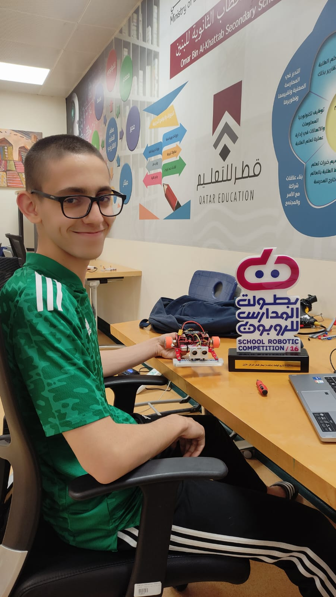
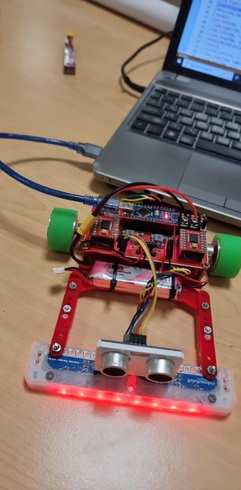
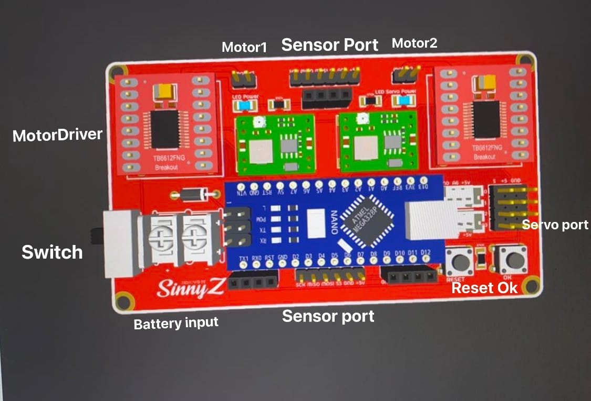

# Line Tracking Robot — OBK Robotics

**1st place, 15th Arab Robotics Competition (Line Tracking) · 1st place, 16th Qatar Schools Robotics Competition (Line Tracking)**

  

---

## The short version

I didn't design or build this robot. It was left at our school by someone else. I got it working, kept it working, tuned it with my teammates, and competed with it. It won.

We competed as part of OBK Robotics, the club I founded at OBK Secondary School for Boys in Doha, Qatar.

---

## Results

| Competition | Category | Result |
| --- | --- | --- |
| 15th Arab Robotics Competition | Line Tracking | 1st place out of 50 teams, representing Qatar |
| 16th Qatar Schools Robotics Competition | Line Tracking | 1st place, leading a team of 3 |

---

## The robot

  
  

---

## What I did

- **Code:** edited the existing line-tracking code and tuned it with my teammates for speed.
- **Troubleshooting:** found and fixed problems with the robot on multiple occasions.
- **Repairs:** re-soldered the motors, and cleaned and fixed the tires to keep traction consistent.
- **Logistics:** honestly, most of the work. Organizing the team and everything around the robot so we could compete.

---

## Main PCB

Not my design. Shown here for reference.

  

---

## Winning

  
  

